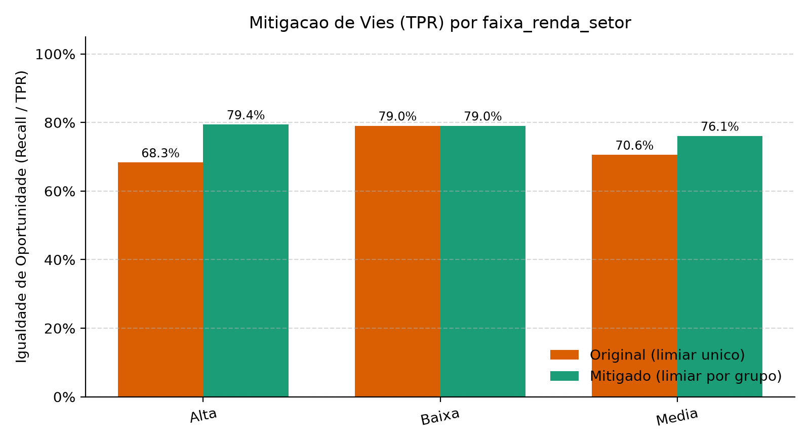
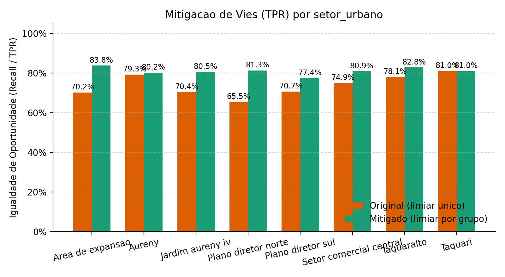
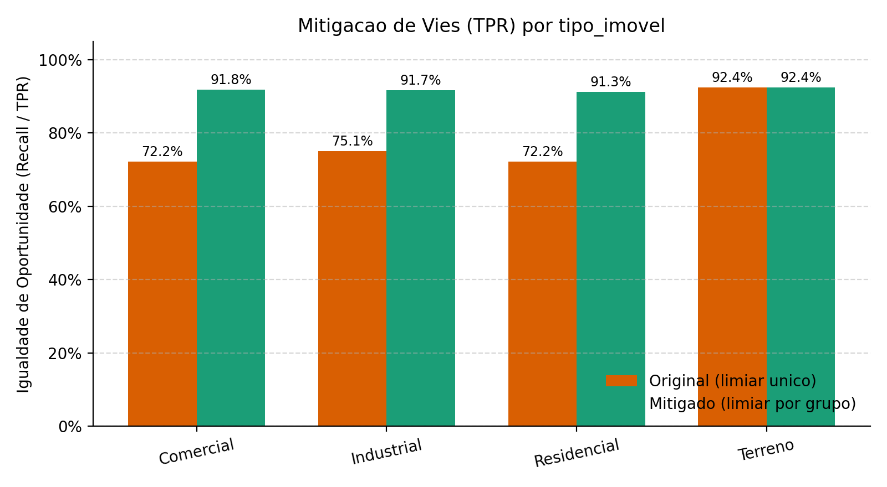
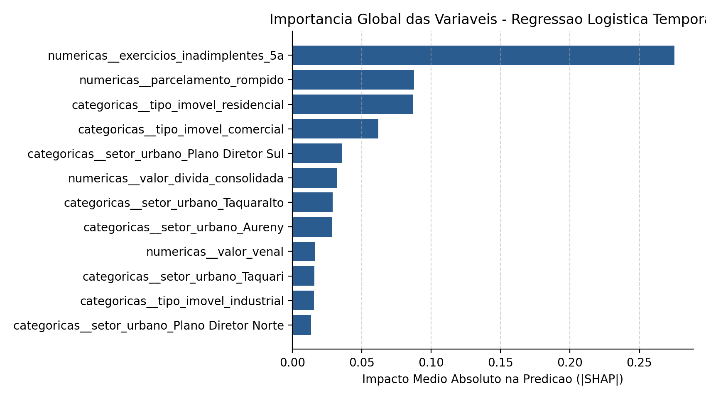
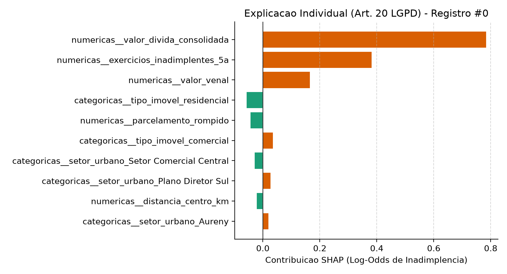

# Relatório de Impacto Algorítmico (RIA) — Modelo de Recuperabilidade da Dívida Ativa (Sefin Palmas)

**Projeto Integrador — Inteligência Tributária | BIINAR UFT, Eixo II 2026/2 | Sprint 5 — E2**

---

## 1. Mapeamento de Dados Pessoais/Sensíveis e Conformidade com a LGPD

O sistema processa dados cadastrais, imobiliários e fiscais estruturados conforme o Modelo Entidade-Relacionamento (`docs/DER.md`). Para mitigar riscos à privacidade desde a concepção (*Privacy by Design*), os identificadores diretos são descartados antes da modelagem (`src/ml/preparar_base.py`), substituindo chaves naturais por hashes pseudonimizados.

### 1.1 Inventário de Dados e Bases Legais (Lei nº 13.709/2018)

| Entidade (`DER.md`) | Atributos Mapeados | Classificação LGPD | Uso no Pipeline / Modelo | Base Legal (LGPD) |
| :--- | :--- | :--- | :--- | :--- |
| `CONTRIBUINTE` | `cnpj_cpf`, `nome`, `contato` | Dado Pessoal Direto | **Excluídos** antes do treino e inferência; mantidos apenas na base restrita da Sefin para contato administrativo. | Art. 7º, III (Execução de políticas públicas) e Art. 7º, II (Cumprimento de obrigação legal - CTN). |
| `CONTRIBUINTE` | `boolean_is_iptu_social` | Dado Pessoal / Indicador de Vulnerabilidade | Usado exclusivamente como **filtro de exclusão formal** (`src/ml/preparar_base.py`), removendo 1.393 beneficiários (idosos, aposentados, pensionistas e PcD de baixa renda) antes de qualquer predição. | Art. 7º, III e Art. 11, II, 'b' (Políticas públicas de proteção social e isenção tributária). |
| `IMOVEL` | `inscricao_imobiliaria`, `logradouro` | Dado Pessoal Indireto | **Excluídos** da base analítica de modelagem. | Art. 7º, III (Execução de políticas públicas). |
| `IMOVEL` | `bairro`, `setor_urbano`, `area_edificada` | Dado Cadastral / Territorial | `setor_urbano` e `area_edificada` entram como variáveis do modelo. `faixa_renda_setor` não entra no treino (usada apenas na auditoria de viés). | Art. 7º, III (Execução de políticas públicas). |
| `DEBITO_TRIBUTARIO` | `tipo_tributo`, `valor_debito`, `data_vencimento`, `status_pagamento` | Dado Financeiro / Fiscal | Variáveis agregadas (dívida consolidada, exercícios inadimplentes, parcelamentos) alimentam o modelo. | Art. 7º, III (Gestão da dívida ativa) e Art. 7º, X (Proteção do crédito público). |
| `LOG_AUDITORIA` / `ANALISTA_FISCAL` | `id_analista`, `nome`, `perfil`, `timestamp`, `filtros_aplicados`, `justificativa_lgpd` | Dado Pessoal Funcional | Rastreabilidade interna de acessos e consultas feitas por servidores da Sefin e Procuradoria. | Art. 7º, II e Art. 37 (Registro de operações de tratamento para auditoria). |

### 1.2 Armazenamento, Retenção e Segurança
* **Minimização e Dados Sensíveis:** Nenhum atributo sensível (raça, origem étnica, saúde, deficiência) ou demográfico (idade, sexo) entra como variável no modelo.
* **Ambiente Atual:** A base utilizada (`data/bruto/carteira_contribuintes_sintetica.csv`) é sintética, gerada apenas para validação acadêmica.
* **Retenção Proposta (Produção):** Os registros de auditoria (`LOG_AUDITORIA`) devem ser retidos por 5 anos (alinhado ao prazo prescricional tributário do Art. 174 do CTN) com acesso restrito por perfil (`ANALISTA_FISCAL`). Os scores (`SCORE_RECUPERABILIDADE`) têm validade mensal, sendo atualizados a cada ciclo de escoragem.

## 2.  Análise de Fairness (Justiça Algorítmica) e Mitigação de Vieses
###  2.1 Metodologia e Métricas Avaliadas
Para verificar se o modelo campeão (Regressão Logística Temporal, com limiar de decisão original de $0{,}23$ e $F_1\text{-Score}$ 
global de $0{,}4209$) reproduz ou amplifica desigualdades socioeconômicas ou territoriais sobre a carteira de teste  ( $N = 55.
821$ registros), realizou-se uma auditoria quantitativa utilizando a biblioteca Fairlearn. Foram avaliados três recortes   
sensíveis — faixa de renda do setor, setor urbano e tipo de imóvel — sob dois critérios formais de equidade:

* **Paridade Demográfica (Demographic Parity):**  
Avalia se a proporção de contribuintes  sinalizados como risco de inadimplência ($\hat{Y} = 1$, chamada de Taxa de Seleção) é 
equilibrada entre os grupos. Adota-se como referência regulatória a Regra dos Quatro  Quintos (4/5), segundo a qual a razão entre 
a menor e a maior taxa de seleção deve ser $\ge 0{,}80$.

⁠* **Igualdade de Oportunidade (Equal Opportunity):**
Mede se a Taxa de Verdadeiros Positivos ($TPR / \text{Recall}$) é equivalente entre os grupos para os contribuintes que 
efetivamente se tornaram inadimplentes ($Y = 1$), garantindo que nenhum subgrupo tenha capacidade preditiva sistematicamente 
inferior.

### 2.2 Resultados Obtidos (Cenário Original vs. Cenário Mitigado)

#### A) Recorte por Faixa de Renda do Setor (`faixa_renda_setor`)

| Subgrupo | Amostras ($N$) | Taxa Real ($Y=1$) | Taxa de Seleção (Original) | Taxa de Seleção (Mitigado) | Igualdade de Oportunidade / TPR (Original) | Igualdade de Oportunidade / TPR (Mitigado) | Limiar Ajustado |
| :--- | :---: | :---: | :---: | :---: | :---: | :---: | :---: |
| **Alta Renda** | 11.844 | 23,33% | 55,75% | 68,00% | 68,33% | 79,41% | 0,220 |
| **Média Renda** | 20.049 | 24,26% | 58,22% | 64,66% | 70,56% | 76,07% | 0,220 |
| **Baixa Renda** | 23.928 | 25,93% | 68,88% | 68,88% | 79,05% | 79,05% | 0,230 |

* **Indicadores de Disparidade:** No modelo original, a Razão de Paridade Demográfica foi de $0{,}8094$ (no limite inferior da faixa aceitável de $0{,}80$), com diferença de $13{,}13\text{ p.p.}$ na taxa de seleção e $10{,}71\text{ p.p.}$ na Igualdade de Oportunidade ($\text{TPR}$) entre baixa e alta renda. Após o ajuste fino de limiares ($0{,}22$ para alta e média renda; $0{,}23$ para baixa renda), a Razão de Paridade Demográfica subiu para $0{,}9388$ e a diferença de $\text{TPR}$ caiu para $3{,}34\text{ p.p.}$, mantendo o $F_1\text{-Score}$ global praticamente inalterado ($0{,}4207$).



#### B) Recorte por Setor Urbano (`setor_urbano`)

| Subgrupo | Amostras ($N$) | Taxa Real ($Y=1$) | Taxa de Seleção (Original) | Taxa de Seleção (Mitigado) | Igualdade de Oportunidade / TPR (Original) | Igualdade de Oportunidade / TPR (Mitigado) | Limiar Ajustado |
| :--- | :---: | :---: | :---: | :---: | :---: | :---: | :---: |
| **Área de Expansão** | 2.925 | 24,31% | 58,53% | 75,62% | 70,18% | 83,83% | 0,210 |
| **Aureny** | 9.546 | 25,75% | 68,12% | 79,12% | 79,29% | 80,19% | 0,225 |
| **Jardim Aureny IV** | 4.047 | 22,81% | 59,03% | 70,84% | 70,42% | 80,50% | 0,215 |
| **Plano Diretor Norte** | 8.289 | 23,42% | 52,74% | 70,41% | 65,53% | 81,30% | 0,215 |
| **Plano Diretor Sul** | 13.077 | 24,70% | 57,90% | 66,16% | 70,68% | 77,43% | 0,220 |
| **Setor Comercial Central** | 3.555 | 23,12% | 62,76% | 68,10% | 74,94% | 80,90% | 0,225 |
| **Taquaralto** | 10.323 | 26,28% | 68,53% | 74,92% | 78,07% | 82,82% | 0,220 |
| **Taquari** | 4.059 | 25,45% | 71,54% | 71,54% | 81,03% | 81,03% | 0,230 |

* **Indicadores de Disparidade:** Antes da mitigação, o recorte territorial violava a Regra dos 4/5, apresentando Razão de Paridade Demográfica de $0{,}7372$ (comparando Plano Diretor Norte, com $52{,}74\%$, e Taquari, com $71{,}54\%$) e diferença de $15{,}49\text{ p.p.}$ no $\text{TPR}$. Com a calibração de limiares específicos por setor (variando entre $0{,}210$ e $0{,}230$), a Razão de Paridade Demográfica elevou-se para $0{,}8749$ (dentro da conformidade $\ge 0{,}80$) e a diferença de $\text{TPR}$ reduziu-se para $6{,}40\text{ p.p.}$ ($F_1\text{-Score}$ global de $0{,}4199$).



---

#### C) Recorte por Tipo de Imóvel (`tipo_imovel`)

| Subgrupo | Amostras ($N$) | Taxa Real ($Y=1$) | Taxa de Seleção (Original) | Taxa de Seleção (Mitigado) | Igualdade de Oportunidade / TPR (Original) | Igualdade de Oportunidade / TPR (Mitigado) | Limiar Ajustado |
| :--- | :---: | :---: | :---: | :---: | :---: | :---: | :---: |
| **Comercial** | 10.362 | 23,89% | 59,60% | 85,43% | 72,20% | 91,84% | 0,175 |
| **Industrial** | 1.623 | 24,46% | 61,18% | 84,47% | 75,06% | 91,69% | 0,170 |
| **Residencial** | 39.912 | 24,67% | 60,63% | 85,47% | 72,22% | 91,27% | 0,175 |
| **Terreno** | 3.924 | 28,36% | 86,31% | 86,31% | 92,36% | 92,36% | 0,230 |

* **Indicadores de Disparidade:** Este foi o recorte de maior assimetria no modelo original, com Razão de Paridade Demográfica de $0{,}6905$ (abaixo do limiar de $0{,}80$) e diferença de $20{,}16\text{ p.p.}$ no $\text{TPR}$ entre imóveis comerciais ($72{,}20\%$) e terrenos ($92{,}36\%$). Após a mitigação pós-processamento, a Razão de Paridade Demográfica atingiu $0{,}9787$ e a diferença de $\text{TPR}$ caiu para apenas $1{,}10\text{ p.p.}$ ($F_1\text{-Score}$ global de $0{,}4111$).


# Indicadores de Disparidade: Este foi o recorte de maior assimetria no modelo original, com Razão de Paridade Demográfica de $0
{,}6905$ (abaixo do limiar de $0{,}80$) e diferença de $20{,}16$ p.p. no $TPR$ entre imóveis comerciais ($72{,}20\%$) e terrenos 
($92{,}36\%$). Após a mitigação pós-processamento, a Razão de Paridade Demográfica atingiu $0{,}9787$ e a diferença de $TPR$ caiu 
para apenas $1{,}10$ p.p. ($F_1\text{-Score}$ global de $0{,}4111$)
.(Inserir aqui a figura: docs/figuras/ria_mitigacao_tipo_imovel.png)

###  2.3 Discussão Honesta dos Vieses e Estratégia de Mitigação
1. **Diagnóstico das Causas:**
Observa-se que o modelo original tende a sinalizar proporcionalmente mais contribuintes de baixa renda ($68{,}88\%$ vs. $55{,}75\%$ na alta renda) e de regiões periféricas/em expansão (Taquari com $71{,}54\%$ e Taquaralto com $68{,}53\%$ vs. Plano Diretor 
Norte com $52{,}74\%$), embora a diferença na inadimplência real entre esses grupos seja de apenas $2{,}6$ a $3{,}5$ pontos 
percentuais. Isso ocorre porque variáveis socioeconômicas territoriais e o histórico de parcelamentos anteriores possuem forte 
correlação com a renda do setor, fazendo com que o algoritmo penalize desproporcionalmente contribuintes de áreas vulneráveis 
(aumentando a taxa de falsos positivos nesses grupos, com diferença de $FPR$ de $19{,}47$ p.p. entre setores urbanos). No recorte 
por tipo de imóvel, terrenos apresentam maior inadimplência real ($28{,}36\%$) e comportamento histórico 
mais volátil, levando o limiar único a sub-sinalizar imóveis comerciais e residenciais.

2. **Eficácia e Trade-off da Mitigação:**
A aplicação de mitigação pós-processamento via otimização de limiares por subgrupo demonstrou-se eficaz para restaurar a equidade 
sem necessidade de alterar a arquitetura do modelo treinado. Em todos os recortes, a Razão de Paridade Demográfica passou a superar o patamar regulatório de $0{,}80$ (atingindo $0{,}87$ a $0{,}98$). Contudo, assume-se de forma transparente o trade-off operacional: ao reduzir o limiar de corte para equalizar o $TPR$ 
(especialmente no recorte de tipo de imóvel, onde os limiares caíram para $0{,}170\text{–}0{,}175$), há elevação na taxa global 
de seleção e leve queda na precisão média (de $\sim 29\%$ para $\sim 26\%$). Portanto, recomenda-se que a mitigação por limiar 
seja utilizada em conjunto com triagem humana e réguas de cobrança amigável (preventiva), evitando medidas coercitivas 
automáticas baseadas exclusivamente no escore.

## 3. Interpretabilidade e Direito à Explicação (Art. 20 da LGPD)

### 3.1 Fundamento Legal e Arquitetura de Explicabilidade
Em conformidade com o **Art. 20 da Lei Geral de Proteção de Dados (Lei nº 13.709/2018)**, o titular dos dados tem o direito de 
solicitar a revisão de decisões tomadas unicamente com base em tratamento automatizado de dados pessoais que afetem seus 
interesses, bem como de receber informações claras e adequadas a respeito dos critérios e dos procedimentos utilizados.

Para assegurar transparência auditável e explicabilidade tanto em nível global (comportamento geral do modelo) quanto local 
(justificativa individualizada por inscrição imobiliária), empregou-se a técnica **SHAP (*SHapley Additive exPlanations*)** por 
meio do `shap.LinearExplainer` sobre o modelo campeão (**Regressão Logística Temporal**, valor-base $E[f(x)] = -1{,}0003$ em 
*log-odds*, equivalente a uma probabilidade média base de $\approx 26{,}89\%$, e limiar de decisão de $0{,}23$). Além disso, como 
medida de governança institucional da Sefin Palmas, nenhuma medida coercitiva (como protesto extrajudicial ou ajuizamento de 
execução fiscal) é disparada automaticamente pelo algoritmo sem revisão prévia de um auditor fiscal.

---

### 3.2 Explicabilidade Global (Principais Variáveis do Modelo)
A análise da média absoluta dos valores SHAP ($|\text{SHAP}|$) em toda a carteira de teste demonstra que as predições do modelo 
são fortemente ancoradas no histórico objetivo de adimplência fiscal do imóvel, reduzindo a dependência de atributos puramente 
territoriais:

| Ranking | Variável (`feature`) | Impacto Médio Absoluto ($\|\text{SHAP}\|$) | Interpretação Técnica |
| :---: | :--- | :---: | :--- |
| **1º** | `exercicios_inadimplentes_5a` | **0,2753** | Principal preditor global: quantidade de exercícios em atraso nos últimos 
5 anos. |
| **2º** | `parcelamento_rompido` | **0,0877** | Histórico de quebra de acordos anteriores de parcelamento tributário. |
| **3º** | `tipo_imovel_residencial` | **0,0869** | Diferenciação de comportamento entre imóveis residenciais e terrenos não 
edificados. |
| **4º** | `tipo_imovel_comercial` | **0,0621** | Perfil de adimplência específico de imóveis comerciais. |
| **5º** | `setor_urbano_Plano Diretor Sul` | **0,0356** | Ajuste territorial referente ao setor Plano Diretor Sul. |
| **6º** | `valor_divida_consolidada` | **0,0321** | Montante acumulado da dívida ativa consolidada (R$). |
| **7º** | `setor_urbano_Taquaralto` | **0,0290** | Ajuste territorial referente ao setor Taquaralto. |
| **8º** | `setor_urbano_Aureny` | **0,0288** | Ajuste territorial referente à região dos Aurenys. |
| **9º** | `valor_venal` | **0,0164** | Avaliação venal do imóvel no cadastro imobiliário. |
| **10º** | `setor_urbano_Taquari` | **0,0160** | Ajuste territorial referente ao setor Taquari. |
| **11º** | `tipo_imovel_industrial` | **0,0156** | Perfil de adimplência de imóveis industriais. |
| **12º** | `setor_urbano_Plano Diretor Norte` | **0,0134** | Ajuste territorial referente ao setor Plano Diretor Norte. |



---

### 3.3 Explicabilidade Local (Estudo de Caso Real — Art. 20 da LGPD)

Para demonstrar como a Secretaria da Fazenda pode responder de forma objetiva a um pedido de esclarecimento ou revisão formulado 
por um contribuinte nos termos do Art. 20 da LGPD, apresenta-se a decomposição SHAP do **Registro de Teste `#0`**, classificado 
acima do limiar operacional ($0{,}23$) com probabilidade estimada de inadimplência de **$56{,}87\%$**:

* **Perfil do Imóvel Auditado (Registro `#0`):** Imóvel residencial localizado no *Setor Comercial Central* ($2{,}19\text{ km}$ 
do centro), área construída de $311{,}20\text{ m}^2$, valor venal de $\text{R\$ } 2.109.034{,}97$, IPTU anual de $\text{R\$ } 14.
521{,}53$, dívida consolidada de $\text{R\$ } 68.779{,}11$, **3 exercícios inadimplentes nos últimos 5 anos** ($598$ dias de 
atraso), 2 notificações emitidas e **nenhum parcelamento rompido** (`0`).

| Fator Explicativo (`feature`) | Dado Observado no Cadastro | Contribuição SHAP (*Log-Odds*) | Efeito na Predição |
| :--- | :---: | :---: | :--- |
| `valor_divida_consolidada` | R$ 68.779,11 | **+0,7837** | Aumenta risco |
| `exercicios_inadimplentes_5a` | 3 exercícios | **+0,3819** | Aumenta risco |
| `valor_venal` | R$ 2.109.034,97 | **+0,1655** | Aumenta risco |
| `tipo_imovel_residencial` | Sim (`residencial`) | **-0,0569** | Reduz risco |
| `parcelamento_rompido` | Não (`0`) | **-0,0430** | Reduz risco |
| `setor_urbano_Setor Comercial Central` | Sim (`Setor Comercial Central`) | **-0,0282** | Reduz risco |
| `distancia_centro_km` | 2,19 km | **-0,0214** | Reduz risco |



#### Tradução em Linguagem Clara para Atendimento ao Contribuinte
Em eventual solicitação administrativa fundamentada no Art. 20 da LGPD, o sistema permite emitir o seguinte parecer explicativo 
auditável:
> *"A classificação de risco elevado (56,87%, acima do corte operacional de 23,00%) decorreu fundamentalmente do montante 
acumulado da dívida consolidada (R$ 68.779,11; impacto SHAP +0,7837) e da recorrência de 3 exercícios inadimplentes nos últimos 
cinco anos (impacto SHAP +0,3819). Em sentido contrário, atuaram como atenuantes do risco o fato de o imóvel ser residencial (-0,
0569), não possuir histórico de parcelamento rompido (-0,0430) e estar situado no Setor Comercial Central (-0,0282). Caso haja 
pagamento, parcelamento ativo ou contestação administrativa dos débitos registrados, o titular poderá requerer revisão humana 
imediata junto ao atendimento da Sefin."*


## 4. Análise de Impactos Sociais, Riscos e Plano de Auditoria Contínua

### 4.1 Mapeamento de Impactos Sociais Positivos e Riscos de Exclusão
A implantação de modelos preditivos na gestão da dívida ativa da Secretaria da Fazenda de Palmas (Sefin) gera externalidades diretas sobre a eficiência arrecadatória do Município e sobre as garantias fundamentais dos contribuintes. A avaliação de impacto socioeconômico abaixo fundamenta as salvaguardas operacionais do sistema:

* **Impactos Sociais Positivos:**
  * **Justiça Fiscal e Capacidade de Investimento:** A priorização baseada em propensão de pagamento permite direcionar esforços administrativos aos devedores com maior capacidade contributiva e liquidez, incrementando a receita própria do Município para políticas públicas essenciais (saúde, educação e infraestrutura urbana) sem elevação de alíquotas tributárias.
  * **Proteção Efetiva a Grupos Vulneráveis:** A trava determinística implementada em `src/ml/protecao_iptu_social.py` e aplicada no pré-processamento, no scoring e no painel (Seção 4.3), que exclui formalmente **1.393 beneficiários do IPTU Social** (idosos, aposentados, pensionistas e pessoas com deficiência de baixa renda), assegura que cidadãos em situação de hipossuficiência não sejam expostos a fluxos automatizados de cobrança ou restrições cadastrais.
  * **Desjudicialização e Redução de Custos Operacionais:** O acionamento preventivo por meio de réguas amigáveis (comunicados digitais, alertas de vencimento e propostas de parcelamento facilitado) antes do protesto extrajudicial ou do ajuizamento de execução fiscal evita o bloqueio patrimonial de contribuintes adimplentes eventuais e reduz a sobrecarga do Judiciário local.

* **Riscos Sociais Identificados e Salvaguardas:**
  * **Risco de Estigmatização Territorial (Falsos Positivos em Áreas Periféricas):** Conforme evidenciado na auditoria de equidade (Seção 2), a aplicação de um limiar único global penalizaria desproporcionalmente regiões periféricas e de menor renda (como Taquari e Taquaralto, com taxas de sinalização até $18{,}8\text{ p.p.}$ acima do Plano Diretor Norte). **Salvaguarda:** Adoção obrigatória dos limiares calibrados por subgrupo via pós-processamento e restrição do uso do escore exclusivamente à priorização de cobrança amigável.
  * **Risco de Erro Cadastral ou Defasagem de Baixa Bancária:** Débitos recentemente quitados via compensação bancária ou sob efeito suspensivo por processo administrativo (impugnação ou pedido de isenção) podem ser escorados indevidamente caso haja latência na sincronização do banco de dados. **Salvaguarda:** Aplicação estrita do princípio *Human-in-the-Loop* (revisão humana obrigatória por auditor fiscal antes de qualquer ato coercitivo) e fluxo administrativo célere de contestação nos termos do Art. 20 da LGPD.

### 4.2 Protocolo de Governança e Auditoria Contínua
Para assegurar que o modelo mantenha conformidade técnica, ética e jurídica ao longo de todo o seu ciclo de vida em produção na Sefin Palmas, estabelece-se o seguinte plano periódico de monitoramento e auditoria:

| Eixo de Auditoria | Periodicidade | Métrica / Critério de Controle | Ação Corretiva em Caso de Desvio |
| :--- | :---: | :--- | :--- |
| **Monitoramento de *Drift* de Dados e Desempenho** | Mensal (a cada ciclo de escoragem) | Queda superior a $5\text{ p.p.}$ no $F_1\text{-Score}$ ou *Recall* em relação à linha de base ($0{,}4209$), ou desvio significativo na distribuição das variáveis (*PSI* $> 0{,}20$). | Re-treinamento supervisionado do modelo com a janela temporal atualizada e revalidação métrica antes da nova rodada de escoragem. |
| **Auditoria de Equidade (*Fairness*)** | Trimestral | Razão de Paridade Demográfica $\ge 0{,}80$ (Regra dos 4/5) e diferença máxima de $\text{TPR} \le 7\text{ p.p.}$ entre recortes de faixa de renda e setor urbano. | Recalibração dos limiares de corte pós-processamento por subgrupo via Fairlearn e revisão das variáveis territoriais. |
| **Verificação de Elegibilidade Social e Privacidade (LGPD)** | Mensal (pré-inferência) | $100\%$ de exclusão dos registros com `boolean_is_iptu_social = True` e ausência integral de identificadores diretos (*PII*) na base de inferência. | Interrupção automática do *pipeline* (`garantir_sem_protegidos()` em `src/ml/protecao_iptu_social.py`) caso qualquer registro protegido vaze para a saída, e execução de `tests/test_iptu_social.py` a cada alteração (Seção 4.3). |
| **Auditoria de Rastreabilidade e Atendimento (Art. 20 LGPD)** | Contínua / Semestral | Integridade dos registros na tabela `LOG_AUDITORIA` (`id_analista`, `timestamp`, `justificativa_lgpd`) e cumprimento do prazo regulamentar nas revisões humanas solicitadas. | Revisão de permissões de acesso por perfil (`ANALISTA_FISCAL`) e aprimoramento dos relatórios individuais SHAP emitidos ao cidadão. |

### 4.3 Proteção do IPTU Social no Código (RNF01)

**Requisito.** O RNF01 (`docs/requisitos.md`) exige $100\%$ de exclusão dos beneficiários do IPTU Social das listas de cobrança preditiva, comprovada por teste automatizado com $0$ registros protegidos na saída do modelo.

**Fundamento legal dos grupos.** O Código Tributário de Palmas (Lei Complementar nº 285/2013, art. 20, II) isenta do IPTU o imóvel cujo contribuinte seja:

| Código no sistema | Grupo protegido | Critério legal |
| :--- | :--- | :--- |
| `idoso` | Idoso | Idade superior a 65 anos |
| `aposentado` | Aposentado | Aposentado |
| `pensionista` | Pensionista | Pensionista |
| `pcd` | Pessoa com deficiência | Deficiência física com incapacidade para o trabalho |

Pelo § 1º do mesmo artigo, a isenção depende ainda de quatro condições **cumulativas**: único imóvel edificado no Município, renda mensal de até 2 salários mínimos, uso exclusivamente residencial e imposto (sem descontos) inferior a 150 UFIP. Por isso os grupos são descritos como "de baixa renda".

**Regra implementada** (`src/ml/protecao_iptu_social.py`):

* **Quem decide a elegibilidade é a Sefin.** O sistema não recalcula idade, renda ou deficiência (a base não tem esses dados e eles não devem entrar no modelo). Ele usa o resultado oficial do cadastro: o indicador booleano (`is_iptu_social`, `iptu_social` ou `boolean_is_iptu_social`, conforme o DER) e, quando existir, o código do grupo (`grupo_iptu_social`). A função `eh_grupo_protegido()` marca o contribuinte como protegido se **qualquer** uma das fontes indicar proteção.
* **Na dúvida, protege (*fail-safe*).** Indicador nulo, vazio ou inválido (ex.: `2`, `"talvez"`) e código de grupo desconhecido fazem o registro sair da cobrança preditiva e ficar pendente de correção cadastral. O pior erro possível é cobrar um beneficiário; retirar da fila alguém sem classificação apenas adia a cobrança até a revisão humana. A política `"erro"` interrompe o pipeline em vez de proteger. Base sem nenhuma coluna de IPTU Social é rejeitada.
* **Exclusão em todas as saídas (defesa em profundidade):**

| Etapa | Onde | O que acontece |
| :--- | :--- | :--- |
| Preparo da base | `preparar_base()` | Exclui os protegidos antes do histórico, do treino e do scoring |
| Scoring | `gerar_scoring_recuperabilidade()` | Se ainda houver indicador na base, exclui antes de prever; com a lista de IDs protegidos, retira e confere a saída |
| Carteira escorada | `python -m src.ml.scoring_recuperabilidade` | Lê os IDs protegidos do cadastro e chama `garantir_sem_protegidos()`, que interrompe o pipeline se algum beneficiário estiver na saída |
| Ranking do painel | `carregar_carteira()` em `src/painel/painel_sefin.py` | Retira qualquer beneficiário antes de montar ranking, mapa e projeção; o simulador não calcula score para quem é marcado como beneficiário |

* **Privacidade desde a concepção.** Depois do filtro, o indicador e o código do grupo são descartados (`remover_colunas_de_protecao()`), porque o código `pcd` revela dado de saúde (dado sensível, LGPD art. 11). Nenhuma saída do modelo carrega essas colunas.

**Evidência do teste automatizado** (`tests/test_iptu_social.py`). O teste roda o pipeline completo sobre a carteira sintética (`preparar_base` → histórico de 12 meses → split temporal → scoring com o modelo campeão) **sem** passar a lista de protegidos ao scoring, e confere a saída de forma independente:

| Verificação | Resultado |
| :--- | :--- |
| Beneficiários identificados na carteira sintética | $1.393$ de $20.000$ contribuintes |
| Beneficiários na saída do pipeline (scores, faixas e ações recomendadas) | $\mathbf{0}$ |
| Não beneficiários escorados | $18.607$ de $18.607$ (a regra não exclui ninguém além dos protegidos) |
| Beneficiários na carteira versionada `data/processado/carteira_teste_escorada.csv` | $0$ |
| Beneficiário injetado artificialmente na saída | Detectado: o pipeline levanta `ViolacaoProtecaoIPTUSocial` |
| Casos de borda (indicador nulo, vazio, inválido; grupo informado com flag falsa; grupo desconhecido; coluna ausente) | Tratados conforme a regra acima |

```text
$ python -m pytest tests/test_iptu_social.py -v
tests/test_iptu_social.py::test_carteira_sintetica_tem_1393_beneficiarios PASSED
tests/test_iptu_social.py::test_pipeline_completo_nao_escora_nenhum_beneficiario PASSED
tests/test_iptu_social.py::test_pipeline_nao_exclui_quem_nao_e_protegido PASSED
tests/test_iptu_social.py::test_carteira_escorada_versionada_nao_tem_beneficiarios PASSED
tests/test_iptu_social.py::test_trava_detecta_beneficiario_injetado_na_saida PASSED
...
70 passed, 1 skipped
```

O teste pulado (`test_painel_nao_exibe_beneficiario`) depende do Streamlit e roda no Codespace, onde o `requirements.txt` o instala.

> **Limitação.** A carteira é sintética e traz apenas o indicador genérico `iptu_social`, sem o código do grupo. A regra por grupo (`grupo_iptu_social`) está pronta e testada com casos construídos, mas só será exercitada com a base real da Sefin.

### 4.4 Parecer Final de Conformidade Algorítmica
Com base nas evidências técnicas documentadas neste Relatório de Impacto Algorítmico — abrangendo a minimização e pseudonimização de dados pessoais desde a concepção (*Privacy by Design*), a exclusão preventiva de contribuintes amparados por políticas de proteção social, a mitigação pós-processamento de disparidades socioeconômicas e territoriais, a explicabilidade global e individual auditável via SHAP e a exigência de supervisão humana sobre qualquer medida restritiva —, atesta-se que o **Modelo de Recuperabilidade da Dívida Ativa** está **apto para operação assistida** em plena conformidade com a Lei Geral de Proteção de Dados (Lei nº 13.709/2018) e com os princípios constitucionais da administração pública.
