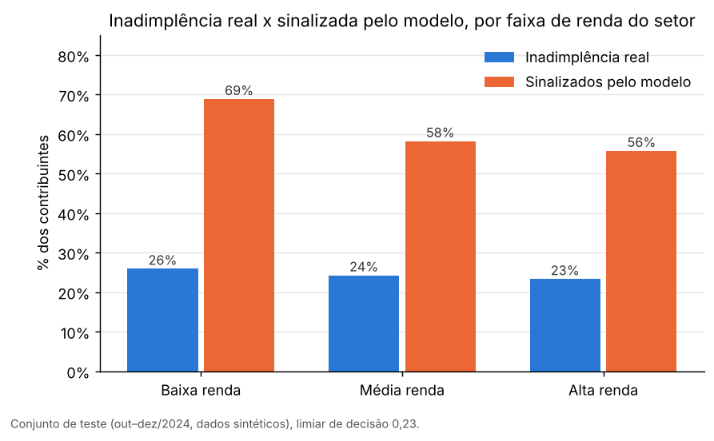

# Model Card — Modelo de Recuperabilidade da Dívida Ativa (Sefin Palmas)

**Projeto Integrador — Inteligência Tributária | BIINAR UFT, Eixo II 2026/2 | Sprint 5 — E1**
Formato baseado em Mitchell et al. (2019), *Model Cards for Model Reporting*. Responsável pelo documento: Pedro Santos Magalhães Neto.

> **Resumo em linguagem simples.** Este modelo estima a chance de um contribuinte de Palmas continuar inadimplente no próximo mês e transforma essa chance numa nota de 0 a 1000 (quanto maior, mais provável que a dívida seja paga). A nota serve para a Secretaria de Finanças **decidir a ordem e o tipo de cobrança**, nunca para punir automaticamente ninguém. Ele foi treinado com **dados sintéticos** (inventados para o projeto), acerta pouco mais do que o acaso (ROC AUC de 0,62) e **sinaliza com mais frequência quem mora em setores de baixa renda** do que a diferença real justificaria. Por isso, **não está pronto para uso real**.

---

## 1. Detalhes do modelo

| Item | Descrição |
| :--- | :--- |
| Nome | `Regressao_Logistica_Temporal` (modelo campeão da Sprint 4) |
| Tipo | Regressão logística com regularização L2 (`scikit-learn`), precedida de padronização das variáveis numéricas e *one-hot encoding* das categóricas |
| O que prevê | `inadimplente_proximo_periodo`: 1 se o contribuinte segue inadimplente no mês seguinte |
| Saída | Probabilidade de inadimplência *p*; **score de recuperabilidade** = (1 − *p*) × 1000; faixa e ação recomendada (tabela abaixo) |
| Limiar de decisão | 0,23 (escolhido por maximizar o F1 na validação). Acima dele, o contribuinte é "sinalizado" como provável inadimplente |
| Arquivos | `models/modelo_campeao_recuperabilidade.joblib` (SHA-256 `d5bbce7d…75af1`) e `models/metadados_modelo_campeao.json` |
| Código | `src/ml/` (preparo, split temporal, modelagem, scoring) e `notebooks/modelo_inadimplencia.ipynb` |
| Versão / data | Gerado em 17/11/2026, `random_state=42` |
| Autores | Equipe do PI: Lucas George Oliveira Nascimento, Jacinto Pereira Brito, Pedro Santos Magalhães Neto, Rafael Vieira Lima, Geovana Souza Mendonça |
| Licença | Uso acadêmico |

**Do score à ação** (`src/ml/scoring_recuperabilidade.py`):

| Score | Faixa | Ação recomendada |
| :--- | :--- | :--- |
| ≥ 750 | A — Alta recuperabilidade | Notificação digital preventiva |
| 450 a 749 | B — Média | Cobrança administrativa ativa + oferta de parcelamento |
| 200 a 449 | C1 / C2 — Baixa | Protesto em cartório (C1, dívida ≥ R$ 1.500, também prioriza execução fiscal) |
| < 200 | D — Crítica | Cobrança passiva / elegível para mutirões (REFIS) |

**Variáveis de entrada (12):** área construída, valor venal, IPTU anual, distância ao centro, exercícios inadimplentes nos últimos 5 anos, tempo de inadimplência, dívida consolidada, parcelamentos anteriores, parcelamento rompido, notificações recebidas, tipo de imóvel e setor urbano. **Não usa** nome, CPF/CNPJ, endereço, idade, sexo, raça ou deficiência. A faixa de renda do setor **não é variável de entrada**, mas é usada nesta auditoria para medir viés.

## 2. Uso pretendido

**Usos previstos**
- Apoiar analistas da Sefin a **priorizar** a ordem da cobrança administrativa da dívida ativa de IPTU, com revisão humana de cada caso.
- Estimar a arrecadação potencial de campanhas de cobrança (painel `src/painel/painel_sefin.py`).
- Fins acadêmicos: demonstrar um pipeline de IA tributária com governança.

**Usuários previstos:** servidores da Sefin capacitados para interpretar probabilidades e limitações do modelo.

**Usos proibidos**
- **Qualquer ação contra beneficiários do IPTU Social** (idosos, aposentados, pensionistas e pessoas com deficiência de baixa renda). Eles são excluídos do modelo por regra de código (seção 6).
- Decidir **sem revisão humana** protesto em cartório, execução fiscal ou inscrição em cadastros de inadimplentes.
- Usar o score para **negar serviços públicos**, certidões, benefícios ou crédito, ou para avaliar o contribuinte fora do contexto tributário.
- Usar o modelo atual em produção: ele foi treinado com **dados sintéticos** e precisa ser retreinado e reauditado com dados reais.
- Usar o setor urbano ou a faixa de renda para justificar tratamento mais severo de uma região.

## 3. Fatores relevantes

- **Faixa de renda do setor** (baixa, média, alta): o fator principal de auditoria, porque a cobrança pode pesar mais sobre quem tem menos.
- **Setor urbano** (8 regiões de Palmas): no dado sintético, cada setor pertence a uma única faixa de renda, então o setor funciona como **substituto (*proxy*) da renda**.
- **Tipo de imóvel** (residencial, comercial, industrial, terreno).
- **Beneficiário do IPTU Social**: grupo protegido, excluído antes do treino.

## 4. Métricas

| Métrica | Valor (teste) | Por que importa |
| :--- | ---: | :--- |
| ROC AUC | 0,617 | Capacidade de ordenar quem paga e quem não paga (0,5 = acaso, 1 = perfeito) |
| KS | 0,168 | Separação entre as distribuições de bons e maus pagadores |
| Recall | 0,739 | Dos que de fato ficaram inadimplentes, quantos o modelo sinalizou |
| Precisão | 0,294 | Dos sinalizados, quantos de fato ficaram inadimplentes |
| F1 | 0,421 | Equilíbrio entre precisão e recall |
| Acurácia | 0,496 | Acertos totais (pouco informativa, porque só ~25% são inadimplentes) |

**Leitura:** o modelo encontra 3 de cada 4 inadimplentes, mas **7 de cada 10 sinalizados pagariam em dia** (falsos positivos). Isso é aceitável só para ações leves e revisadas por um humano, nunca para ações punitivas automáticas.

**Comparação:** com o limiar padrão de 0,5, os modelos de base tinham 75% de acurácia, mas F1 de apenas 0,05, porque quase não sinalizavam ninguém. Random Forest e Gradient Boosting tunados chegaram à mesma AUC (0,615 a 0,616), sem ganho. O arquivo `metricas_modelagem_avancada.json` registra o Gradient Boosting como campeão daquela etapa, mas o modelo serializado e usado pelo painel é a Regressão Logística. Como o desempenho é equivalente, as conclusões não mudam; recomenda-se unificar esse registro.

**Métricas de justiça (fairness)**, calculadas por `src/ml/model_card_metricas.py`:
- **Paridade demográfica**: razão entre a menor e a maior taxa de seleção dos grupos. Pela "regra dos 4/5", valores abaixo de 0,8 indicam disparidade.
- **Igualdade de oportunidade**: diferença de recall (TPR) entre os grupos; idealmente próxima de zero.
- **Diferença de falsos positivos (FPR)**: quem pagaria em dia e mesmo assim foi sinalizado.

## 5. Dados de avaliação

Conjunto de **teste** do split temporal: os meses de **outubro a dezembro de 2024** (55.821 registros, 18.607 contribuintes × 3 meses), posteriores a todo o período de treino, o que simula o uso real (prever o futuro com o passado). A taxa de inadimplência no teste é de 24,8%. Os resultados por contribuinte estão em `data/processado/carteira_teste_escorada.csv`.

## 6. Dados de treinamento

| Item | Descrição |
| :--- | :--- |
| Origem | Carteira **sintética** de 20.000 contribuintes (`data/bruto/carteira_contribuintes_sintetica.csv`), expandida pela equipe em um histórico de 12 meses (jan–dez/2024) por `src/ml/gerar_historico_sintetico.py` |
| Por que sintética | A base individual real da dívida ativa ainda não foi disponibilizada pela Sefin |
| Exclusão do IPTU Social | **1.393 contribuintes (7,0%)** removidos antes de qualquer etapa por `src/ml/preparar_base.py`. 88% deles estão em setores de baixa renda |
| Identificadores | CPF/CNPJ, nome, contato, logradouro e inscrição imobiliária são removidos; o ID usado é um hash |
| Split temporal | Treino jan–jul/2024 (130.249 registros, 27,9% inadimplentes); validação ago–set (37.214; 24,7%); teste out–dez (55.821; 24,8%) |

**Composição e sub-representações** (contribuintes modelados):

| Grupo | Participação | Observação |
| :--- | ---: | :--- |
| Baixa renda | 42,9% | Grupo mais numeroso |
| Média renda | 35,9% | |
| Alta renda | 21,2% | Menos representada |
| Imóvel industrial | 2,9% | **Sub-representado**: métricas desse grupo são pouco estáveis |
| Terreno | 7,0% | Pequeno, mas é o grupo com mais sinalizações (86%) |
| Área de Expansão | 5,2% | Menor setor |

**Como o alvo foi gerado (importante para interpretar tudo acima).** A inadimplência de cada mês foi **simulada por uma fórmula** que depende de exercícios inadimplentes, parcelamento rompido, valor da dívida, ser terreno e um efeito sazonal. A fórmula **não usa** setor nem renda. O modelo, portanto, aprende uma regra criada pela equipe, e não o comportamento real dos contribuintes de Palmas. Na carteira original, a inadimplência variava muito mais entre faixas de renda (59,6% na baixa contra 37,8% na alta) do que no histórico simulado (25,9% contra 23,3% no teste). Com dados reais, as diferenças entre grupos e os vieses podem ser **maiores** que os medidos aqui.

## 7. Análise quantitativa por subgrupo



**Por faixa de renda do setor** (teste, limiar 0,23):

| Faixa | n | Inadimplência real | Sinalizados | Recall (TPR) | Falsos positivos (FPR) | Precisão | AUC |
| :--- | ---: | ---: | ---: | ---: | ---: | ---: | ---: |
| Baixa | 23.928 | 25,9% | **68,9%** | 79,0% | **65,3%** | 29,8% | 0,609 |
| Média | 20.049 | 24,3% | 58,2% | 70,6% | 54,3% | 29,4% | 0,621 |
| Alta | 11.844 | 23,3% | 55,7% | 68,3% | 51,9% | 28,6% | 0,618 |

| Teste de fairness | Renda | Setor urbano | Tipo de imóvel |
| :--- | ---: | ---: | ---: |
| Paridade demográfica (razão; ideal ≥ 0,8) | 0,81 | **0,74** | **0,69** |
| Igualdade de oportunidade (diferença de TPR) | 10,7 p.p. | 15,5 p.p. | 20,2 p.p. |
| Diferença de falsos positivos | 13,4 p.p. | 19,5 p.p. | 28,3 p.p. |
| Diferença de inadimplência real | 2,6 p.p. | 3,5 p.p. | 4,5 p.p. |

Entre os setores, Taquari (71,5% sinalizados), Taquaralto (68,5%) e Aureny (68,1%), todos de baixa renda, lideram, contra 52,7% no Plano Diretor Norte, de alta renda. Entre os tipos de imóvel, terrenos são sinalizados 86,3% das vezes, contra cerca de 60% nos demais. Tabelas completas em `models/metricas_subgrupos.json`.

## 8. Análise de viés e considerações éticas

**Viés encontrado.** A inadimplência real difere só **2,6 pontos** entre baixa e alta renda, mas o modelo sinaliza **13,1 pontos** a mais na baixa renda, ou seja, **amplifica a diferença real em cerca de 5 vezes**. O efeito mais preocupante está nos falsos positivos: um contribuinte de baixa renda que **pagaria em dia** tem 65% de chance de ser sinalizado, contra 52% na alta renda. Isso também aparece nas ações: só 31% da baixa renda cai na faixa A (notificação preventiva leve), contra 54% da alta renda; o restante vai para cobrança ativa. Na regra dos 4/5, a renda fica no limite (0,81), e setor (0,74) e tipo de imóvel (0,69) a violam.

**Por que acontece.** Pelos pesos do modelo, o fator mais forte é o número de **exercícios inadimplentes nos últimos 5 anos**, que é mais alto na baixa renda (média de 1,9 contra 1,2 na alta). O peso do setor urbano em si é pequeno. Somado ao **limiar baixo (0,23)** e à **baixa capacidade de discriminação** (AUC 0,62), pequenas diferenças de histórico empurram muito mais pessoas de baixa renda para cima do limiar. Em outras palavras, o modelo trata o passado de dificuldade financeira como sinal forte de inadimplência futura, mais do que os dados justificam.

**Riscos se fosse usado assim.** Concentrar a cobrança e os constrangimentos (notificações, protesto) nas regiões mais pobres de Palmas, reforçando desigualdades; cobrar quem pagaria espontaneamente, gerando custo e desconfiança; e criar um ciclo de retroalimentação, em que mais cobrança gera mais registros negativos, que geram mais cobrança.

**Proteções já implementadas.**
- Exclusão formal do IPTU Social antes do treino e do scoring (`src/ml/preparar_base.py`).
- Nenhum dado pessoal direto ou atributo sensível (idade, raça, deficiência) como entrada; IDs pseudonimizados por hash.
- Split temporal, que evita "ver o futuro" e superestimar o desempenho.
- Painel com aviso de dados sintéticos e métricas por subgrupo visíveis ao analista.

**LGPD.** Por envolver decisão automatizada que afeta interesses do titular, o uso real deve garantir o **direito à revisão e à explicação** (Art. 20). Este card registra as variáveis e a lógica de decisão; o Relatório de Impacto Algorítmico (E2) detalha a base legal, a retenção e a explicação individual (SHAP/LIME).

## 9. Ressalvas e recomendações

1. **Não usar em produção** antes de retreinar com a base real da dívida ativa e repetir esta auditoria.
2. **Usar só para ações leves com revisão humana** (notificação, oferta de parcelamento). Protesto e execução fiscal exigem análise individual por um servidor.
3. **Mitigar o viés por renda** antes do uso real, testando: limiares por grupo ou um limiar mais alto, para reduzir falsos positivos; remover `setor_urbano`, ou trocá-lo por variáveis menos ligadas à renda; reponderar o treino; e pós-processamento para igualdade de oportunidade. A análise detalhada e a mitigação escolhida ficam no RIA (E2).
4. **Monitorar continuamente**: rodar `python -m src.ml.model_card_metricas` a cada retreino e definir um alarme se a paridade demográfica de qualquer fator cair abaixo de 0,8.
5. **Melhorar o sinal**: a AUC de 0,62 é fraca. Com dados reais, incluir histórico de pagamentos e testar modelos mais expressivos, sempre reavaliando o fairness.
6. **Unificar o registro do modelo campeão** entre `metadados_modelo_campeao.json` e `metricas_modelagem_avancada.json`.

## 10. Contato e contestação

- **Equipe do projeto:** abrir uma *issue* em https://github.com/Lucas-George-Oliveira/inteligencia_tributaria/issues ou contatar o responsável pelo repositório, Lucas George Oliveira Nascimento (`@Lucas-George-Oliveira`).
- **Em uso real (proposta):** todo contribuinte afetado por uma ação sugerida pelo modelo deveria poder **solicitar a revisão por um servidor e a explicação dos fatores** que levaram à classificação, pelos canais de atendimento da Sefin e pela Ouvidoria do Município, sem custo e com prazo de resposta definido, conforme o Art. 20 da LGPD.

## Como reproduzir os números deste card

```bash
pip install -r requirements.txt
python -m src.ml.model_card_metricas        # gera models/metricas_subgrupos.json e a figura
python -m pytest tests/test_model_card_metricas.py -v
```

**Referência:** Mitchell, M. et al. (2019). *Model Cards for Model Reporting*. Proceedings of the Conference on Fairness, Accountability, and Transparency (FAT\* '19), p. 220–229.
