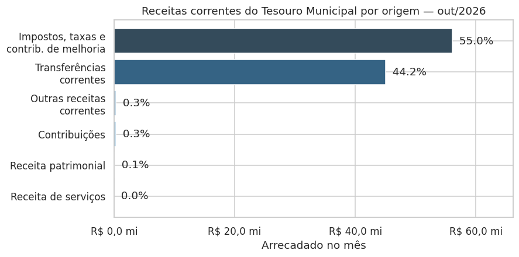
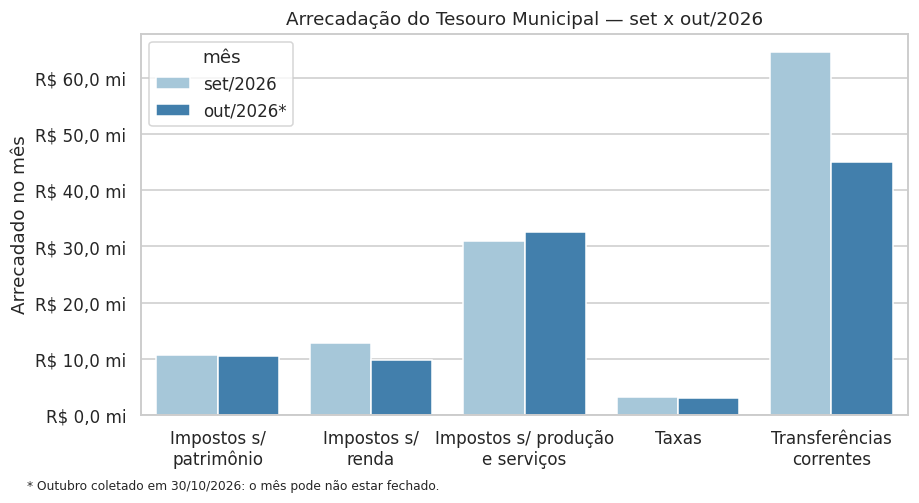
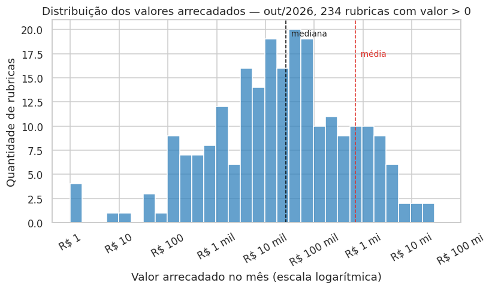
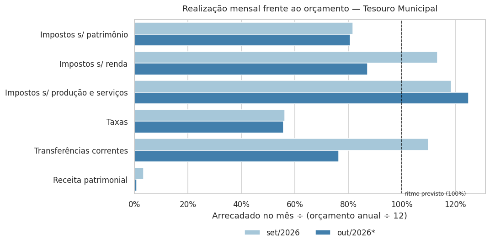
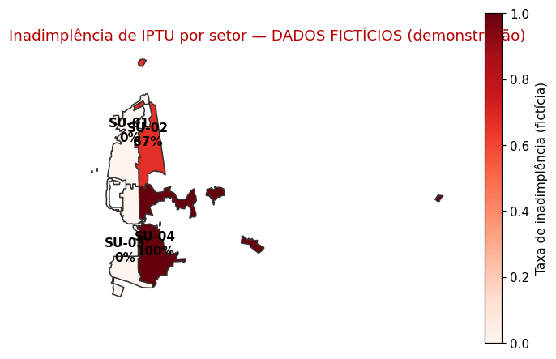
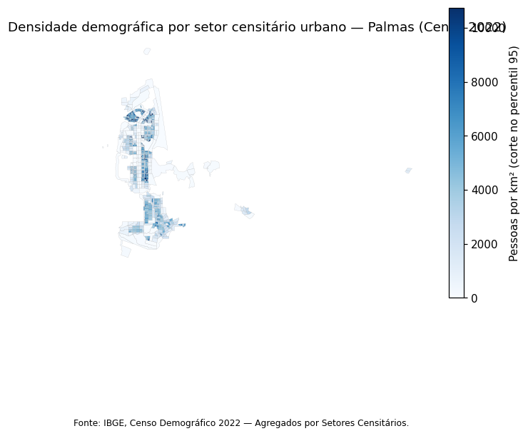

# Relatório de Análise Exploratória (EDA) — Sprint 3

**Projeto Integrador — Inteligência Tributária (Sefin Palmas) | BIINAR UFT, Eixo II 2026/2**
Entregável E3 | Responsável: Pedro Santos Magalhães Neto

Notebooks de origem: [`notebooks/eda_receitas.ipynb`](../notebooks/eda_receitas.ipynb) e [`notebooks/mapas_geoespaciais.ipynb`](../notebooks/mapas_geoespaciais.ipynb). Todos os números deste relatório são reproduzidos ao executar esses notebooks (ver README, seção 3.2).

## 1. Dados analisados

| Item | Valor |
| :--- | :--- |
| Fonte | API de receitas da Prefeitura de Palmas (`sgreceitas`), coletada em 30/10/2026 |
| Registros coletados | 3.000, de 180.997 disponíveis na API (1,7%) |
| Período | Setembro (incompleto) e outubro de 2026 |
| Órgãos | 39 |
| Base tratada | `data/processado/receitas_tratadas_*.csv` (3.000 válidos, 0 rejeitados) |
| Contexto socioeconômico | IBGE, Censo 2022, Agregados por Setores Censitários (malha com atributos) |

**Atenção ao escopo.** Os dados são **receitas orçamentárias agregadas** (quanto a prefeitura previu e arrecadou por tipo de receita), não débitos individuais de contribuintes. Esta EDA, portanto, descreve a **arrecadação**. O mapa de inadimplência (seção 5) usa os dados piloto **fictícios** do banco apenas para demonstrar o método.

## 2. Qualidade dos dados

Cerca de 40% das linhas (1.215) têm arrecadação zero no mês, e 24 linhas têm valores negativos, que correspondem a deduções contábeis, normais em orçamento público. As colunas `unidade_id` e `unidade_nome` estão 100% vazias, e `valor_arrecado_periodo` é idêntica a `valor_arrecado_mes`.

**Os códigos de receita são hierárquicos.** A linha "Impostos" (código `111`) já contém a soma de "Impostos sobre o patrimônio" (`1112`), "sobre a renda" (`1113`) e assim por diante. Somar todas as linhas de outubro daria R$ 1,2 bilhão, quando o valor sem dupla contagem é de cerca de R$ 151 milhões. Por isso a análise usa ou as linhas mais detalhadas de cada ramo ("folhas"), ou as linhas de total calculadas pelo próprio sistema.

## 3. Estatísticas descritivas

Valores arrecadados nas 234 rubricas-folha de outubro/2026 com valor positivo (todos os órgãos):

| Mínimo | 1º quartil | Mediana | Média | 3º quartil | Percentil 90 | Máximo |
| ---: | ---: | ---: | ---: | ---: | ---: | ---: |
| R$ 1,00 | R$ 2.923,53 | R$ 26.455,97 | R$ 691.408,36 | R$ 192.677,91 | R$ 1.289.685,19 | R$ 29.442.709,54 |

A média é 26 vezes maior que a mediana, e os 10% maiores lançamentos concentram 84% do valor arrecadado. É uma distribuição extremamente assimétrica.

## 4. Visualizações

Os gráficos 1, 2 e 4 usam o **Tesouro Municipal** (órgão que recebe os tributos) e as linhas de total do sistema, que estão completas nos dois meses.

### Gráfico 1 — Composição

**Leitura:** em outubro/2026, a arrecadação própria (impostos, taxas e contribuições de melhoria) foi a maior fonte das receitas correntes do Tesouro, com 55% do total, seguida pelas transferências de outros entes (44%); as demais origens somam menos de 1%. **A arrecadação de tributos municipais, foco do nosso modelo, sustenta cerca de metade do caixa corrente da prefeitura.**

### Gráfico 2 — Evolução

**Leitura:** de setembro para outubro, os impostos sobre patrimônio (−1%), sobre produção e serviços (+5,5%) e as taxas (−1%) ficaram praticamente estáveis, enquanto os impostos sobre renda caíram 23% e as transferências correntes, 30%. Como outubro foi coletado antes do fim do mês e há **só dois pontos no tempo**, não é possível falar em tendência ou sazonalidade.

### Gráfico 3 — Distribuição

**Leitura:** os valores se espalham por quase oito ordens de grandeza (de R$ 1 a quase R$ 30 milhões), e a metade central das rubricas fica entre cerca de R$ 3 mil e R$ 190 mil. A média fica muito à direita da mediana por causa de poucos valores enormes. **Na Sprint 4, valores monetários devem entrar no modelo em escala logarítmica.**

### Gráfico 4 — Relação

**Leitura:** a razão entre o arrecadado no mês e um doze avos do orçamento anual mostra que, nos dois meses, os impostos sobre patrimônio (cerca de 80%) e as taxas (cerca de 56%) ficaram **abaixo** do ritmo previsto, os impostos sobre produção e serviços ficaram **acima** (cerca de 120%), e os impostos sobre renda e as transferências oscilaram (acima em setembro, abaixo em outubro). Parte disso pode ser efeito de calendário de pagamento, o que reforça que **o modelo precisa de vários meses e anos de dados** para separar inadimplência de sazonalidade.

## 5. Mapas geoespaciais

Versões interativas (abrir no navegador, com informações ao passar o mouse): [`docs/mapas/`](mapas/).

### Mapa 1 — Inadimplência por setor urbano (DADOS FICTÍCIOS)

Os 7 débitos de IPTU dos dados piloto foram agregados pelo setor urbano do imóvel (CPF e CNPJ foram descartados na leitura, conforme a LGPD). Como os dados piloto não têm localização real, a área urbana do distrito-sede foi dividida em quatro faixas arbitrárias de norte a sul, uma para cada setor piloto.

**Leitura:** o mapa demonstra o método: cada setor recebe a proporção dos seus débitos de IPTU que estão vencidos (SU-01: 0%, SU-02: 67%, SU-03: 0%, SU-04: 100%), e a cor mais escura indica maior inadimplência. Com dados fictícios e tão poucos débitos, **o mapa não permite nenhuma conclusão sobre Palmas**; quando a base real estiver disponível, basta trocar a fonte e usar o setor real de cada imóvel.

### Mapa 2 — Densidade demográfica por setor censitário urbano (IBGE, dados reais)

Fonte: IBGE, Censo Demográfico 2022. Considera os setores urbanos do distrito-sede de Palmas; os distritos urbanos afastados ficaram de fora para não comprimir o mapa. A escala de cores é cortada no percentil 95, porque alguns setores muito pequenos (quadras com prédios, com menos de 0,1 km²) passam de 25 mil hab/km² e escureceriam o resto do mapa.

**Leitura:** a população urbana do distrito-sede não se distribui de forma contínua: forma núcleos densos (no extremo norte da área urbana, numa faixa estreita no centro e no bloco ao sul) separados por grandes áreas pouco ocupadas, e as bordas da cidade têm baixa densidade. **Para a Sprint 4, indicadores do Censo por setor, como a densidade, podem virar atributos socioeconômicos de cada imóvel**, desde que a base de débitos traga a localização.

## 6. Conclusões

1. Os tributos municipais respondem por cerca de metade das receitas correntes do Tesouro.
2. Os valores são extremamente assimétricos, então a modelagem deve usar transformação logarítmica.
3. A realização frente ao orçamento varia muito entre tipos de receita.
4. Palmas tem ocupação urbana em núcleos, o que justifica analisar a inadimplência por setor.

## 7. Limitações e recomendações para a Sprint 4

1. **Obter a base de débitos da dívida ativa** (individual, anonimizada, com vencimento, status e localização do imóvel). Sem ela, não é possível treinar um modelo de inadimplência.
2. **Ampliar a coleta**: hoje ela cobre 1,7% da API. Coletar vários anos e somente meses fechados.
3. **Respeitar a hierarquia dos códigos** em qualquer soma feita sobre a tabela `receitas_sefin_etl`.
4. **Remover colunas vazias ou redundantes** no ETL (`unidade_*`, `valor_arrecado_periodo`).
5. **Substituir o Mapa 1** pelo mapa com dados reais assim que a base de débitos estiver disponível; o código já está pronto para isso.
